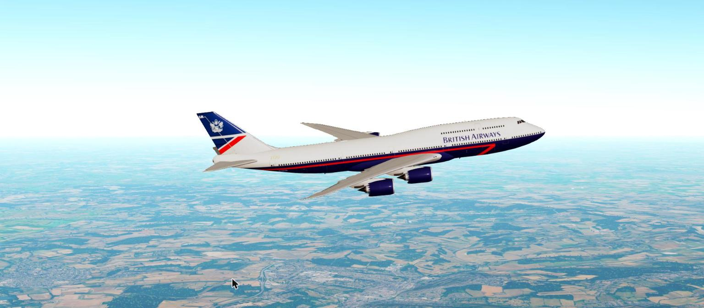
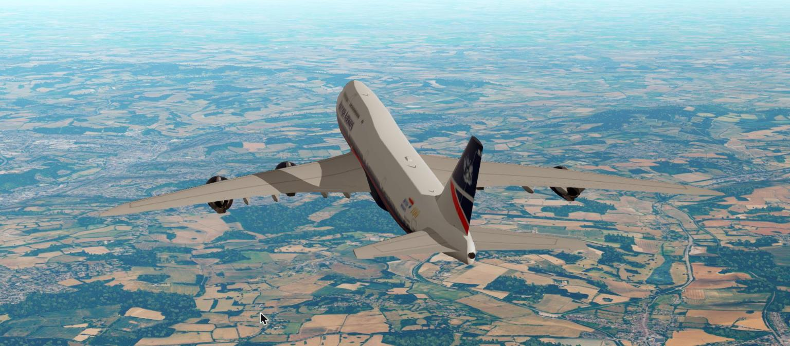
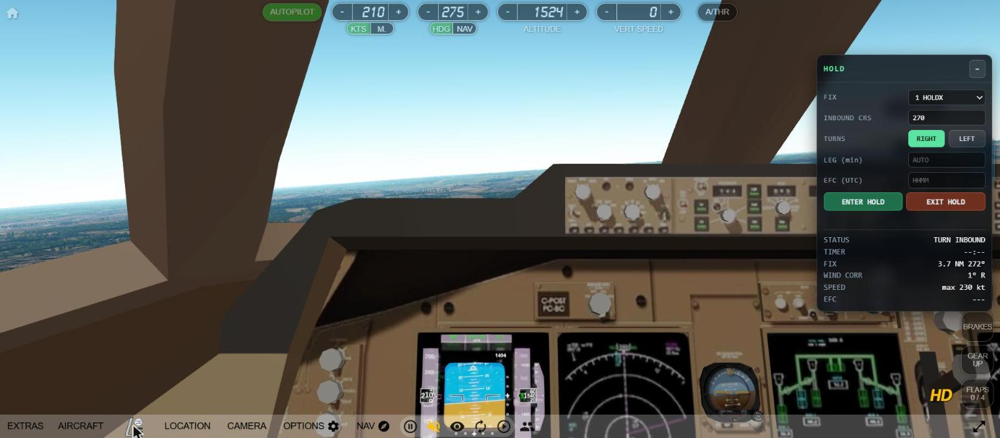
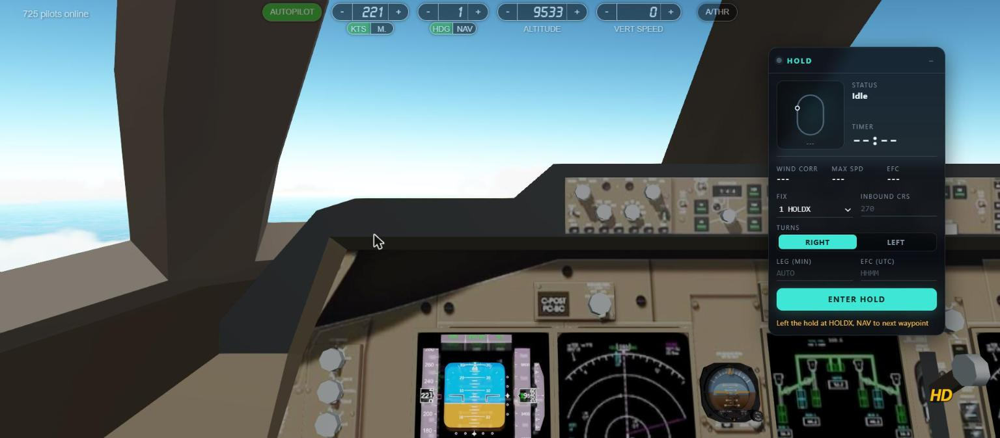
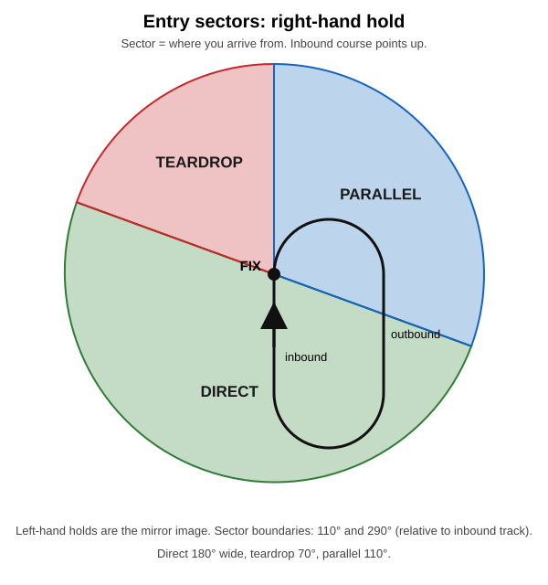

# GeoFS Holding Pattern

**Fly a proper ICAO racetrack hold in GeoFS, hands-off.** Pick an FMC waypoint, set the inbound course, and the autopilot flies the entry, the turns, the legs and the exit, wind included.

[**Install (one click)**](https://raw.githubusercontent.com/nafeesnazzim/geofs-holding-pattern/main/geofs-holding-pattern.user.js) · needs [Tampermonkey](https://www.tampermonkey.net/) (or another userscript manager)

**The panel in action:** inside the 747-8i cockpit mid-hold, then after a clean exit.

## Features

- **Any FMC waypoint** as the hold fix, chosen from a dropdown.
- **All three entries:** direct, teardrop and parallel, picked automatically from your arrival track. Left- and right-hand holds.
- **Standard-rate turns** (3°/s, or 25° bank if that is lower) by steering the heading bug (NAV switches to HDG while holding).
- **Wind drift correction** on every leg, with the outbound time trimmed from the measured inbound leg so you actually arrive on time.
- **Leg time:** AUTO (1 min up to 14 000 ft, 1.5 min above) or set 0.5-5 min.
- **EFC time (UTC HHMM):** optional expect-further-clearance clock.
- **ICAO maximum holding speed** shown and applied (230 kt up to 14 000 ft, 240 kt to 20 000 ft, 265 kt to 34 000 ft, M0.83 above), and your old speed is restored on exit.
- **Clean exit:** crosses the fix inbound, then re-engages NAV to the next waypoint with no speed dip.
- **Sleek avionics-style panel** with a live racetrack diagram that tracks your aircraft. Press **Shift+H** to cycle full panel, slim pill and hidden (the hold keeps running), and drag it anywhere. Silent (no sounds). Units: kt, ft, NM.

## Install

1. Install [Tampermonkey](https://www.tampermonkey.net/).
2. Click **[this link](https://raw.githubusercontent.com/nafeesnazzim/geofs-holding-pattern/main/geofs-holding-pattern.user.js)** and press **Install**.
3. Open [GeoFS](https://www.geo-fs.com/geofs.php). A **HOLD** panel appears on the right.

Updates arrive automatically through Tampermonkey.

## How to use

1. Load a flight plan in the GeoFS FMC and turn the autopilot on.
2. In the HOLD panel, choose the **FIX** (a waypoint from your plan).
3. Enter the **INBOUND CRS** (the course you fly *to* the fix, in degrees).
4. Choose **RIGHT** or **LEFT** turns.
5. Leave **LEG** empty for AUTO, or type minutes (0.5-5).
6. Optionally enter the **EFC** as UTC HHMM.
7. Press **ENTER HOLD**. The panel shows status, timer, wind correction, speed and EFC.
8. Press **EXIT HOLD** (the same button) when you are cleared. You leave the hold at the fix and NAV resumes towards the next waypoint.

Turning the autopilot off cancels the hold.

## Entry types

- **Direct:** turn onto the hold outbound at the fix.
- **Teardrop:** fly outbound 30° off the outbound track, then turn back to the inbound course.
- **Parallel:** fly the outbound track, then turn back and rejoin the inbound course.

## Tested

Flown live in GeoFS and simulated (thousands of randomised runs plus edge cases):

| Aircraft | Notes |
|---|---|
| Boeing 737-700 | direct entry, 39 kt crosswind with turbulence |
| Airbus A380 | left teardrop at FL280 |
| Airbus A350 | Mach mode at FL360, left parallel |
| Boeing 777-300ER, 787-8 | right entries |
| Boeing 747-8i | hold flown after a livery swap, clean exit |
| Embraer E190 | left teardrop |
| Cessna 172 | low and slow |

Max bank stayed at or under about 24° in all flights.

## Known limits

- Tested with winds up to about 40 kt, the most the GeoFS slider allows.
- Sluggish heavy aircraft (such as the A380) take about 30 s to roll into the turn. This is deliberate, to keep bank safe.
- Changing the flight plan while holding may confuse the "next waypoint" on exit.
- Not every aircraft was re-flown on the latest version.
- Written for GeoFS as it is today. A GeoFS update may break it; please open an issue if so.

## Feedback

Found a bug? [Open an issue](https://github.com/nafeesnazzim/geofs-holding-pattern/issues) with your aircraft, altitude, wind and what happened.

## Changelog

See [CHANGELOG.md](CHANGELOG.md).

## Licence

[MIT](LICENSE) © Nuffy. Not affiliated with GeoFS.
